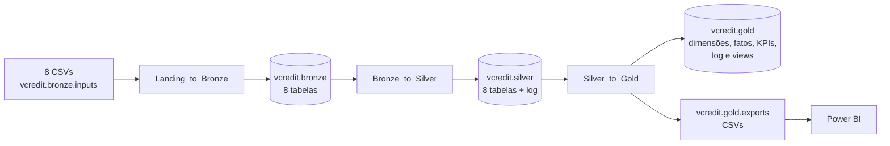

# Arquitetura do pipeline V-Credit

Arquitetura medalhão no Databricks Free Edition, com Unity Catalog. São três notebooks, um para cada passagem de camada, executados por um Job com três tasks encadeadas. Todas as gravações substituem o conteúdo anterior, então o pipeline pode rodar várias vezes sem duplicar dados.

## Catálogo

| Objeto | Tipo | Conteúdo |
|---|---|---|
| `vcredit` | Catálogo | Projeto do case |
| `vcredit.bronze` | Schema | Dados como chegaram, com todas as colunas em texto |
| `vcredit.bronze.inputs` | Volume | Os 8 CSVs de origem |
| `vcredit.silver` | Schema | Dados tratados e tipados, uma tabela por base, mais o log de qualidade |
| `vcredit.gold` | Schema | Modelo estrela, indicadores, log consolidado e views de análise |
| `vcredit.gold.exports` | Volume | CSVs da Gold para o Power BI |
| `vcredit.auditoria` | Schema | Conferência de idempotência, fora do pipeline |

## Landing_to_Bronze

Recebe os arquivos e grava sem alterar os valores, garantindo rastreabilidade.

- Cria o catálogo, os schemas e o Volume de entrada com `IF NOT EXISTS`.
- Confere se os 8 arquivos estão no Volume. Se faltar algum, o notebook para com erro e o Job não segue.
- Lê cada arquivo com o encoding correto, mantém todas as colunas como texto e padroniza os nomes das colunas em minúsculas.
- Adiciona `ingestion_datetime` e `arquivo_origem` em todas as tabelas.
- Compara a quantidade de registros lidos com a gravada.

| Arquivo | Tabela | Encoding |
|---|---|---|
| `chamados.csv` | `tb_chamados` | UTF-8 |
| `Chamados_Hora.CSV` | `tb_chamados_hora` | ISO-8859-1 |
| `clientes.csv` | `tb_clientes` | ISO-8859-1 |
| `custos.csv` | `tb_custos` | UTF-8 |
| `pesquisa_satisfacao.csv` | `tb_pesquisa_satisfacao` | UTF-8 |
| `canais.csv` | `tb_canais` | UTF-8 |
| `base_motivos.csv` | `tb_motivos` | UTF-8 |
| `base_atendentes.csv` | `tb_atendentes` | UTF-8 |

## Bronze_to_Silver

Aplica as regras de negócio de cada base e entrega dados tipados, padronizados e confiáveis. As bases de referência (canais, motivos, atendentes e clientes) são tratadas primeiro, porque os chamados dependem delas para associar canal, motivo e atendente.

| Tabela | Principais tratamentos |
|---|---|
| `tb_canais` | Nome e tipo padronizados; nova coluna de nível no funil (Autosserviço, N1, N2) |
| `tb_motivos` | Categoria e criticidade padronizadas; 3 motivos sem categoria classificados pelos critérios do case; chave de associação para o texto livre dos chamados |
| `tb_atendentes` | Nível padronizado para 1 e 2; datas convertidas; status recalculado pela data de desligamento |
| `tb_clientes` | Região padronizada; data de cadastro em dois formatos; idade válida entre 18 e 100; nova faixa etária; e-mail sem "@" vira NULL; `id_cliente` com 11 dígitos |
| `tb_chamados_hora` | Datas convertidas; ano de abertura corrigido; virada de meia-noite; desistência; tempos de espera e atendimento recalculados |
| `tb_chamados` | Duplicatas removidas; horários, tempos e cliente vindos da `tb_chamados_hora`; motivo e canal associados às referências; resolvido padronizado; atendentes inexistentes viram NULL; vínculo e nível do atendente sinalizados |
| `tb_custos` | Duplicatas removidas; valor convertido para decimal; negativos corrigidos pelo valor absoluto; zero vira NULL; só custos de chamados existentes |
| `tb_pesquisa_satisfacao` | Nota de 1 a 5, demais valores viram NULL; pesquisas duplicadas consolidadas; nova coluna `satisfeito` (notas 4 e 5) |
| `tb_log_qualidade` | Uma linha por regra aplicada, com base, regra, linhas afetadas e total de linhas |

Princípios adotados:

- **Preservar a origem.** Quando um valor é corrigido, o original fica em uma coluna própria (`canal_original`, `motivo_original`, horários originais, valor original do custo).
- **Sinalizar em vez de apagar.** Inconsistências corrigidas ou mantidas recebem uma flag e entram no log com a quantidade de linhas afetadas.
- **Parar diante de conflitos sem regra segura.** Custos ou notas diferentes para o mesmo chamado, chaves repetidas ou um canal fora do de-para interrompem o pipeline, em vez de escolher um registro ao acaso.
- **Não transformar ausência em zero.** Custo, nota e tempos ausentes ficam NULL.

## Silver_to_Gold

Modela os dados em estrela para análise e para o painel.

| Tabela | Grão |
|---|---|
| `dim_calendario` | Um dia, com chave `AAAAMMDD` |
| `dim_cliente` | Um cliente, sem nome e e-mail |
| `dim_motivo` | Um motivo |
| `dim_atendente` | Um atendente, mais os membros `-1` (autosserviço) e `-2` (ID inválido) |
| `dim_canal` | Canal × fluxo (Telefone ou Digital) |
| `fact_chamados` | Um chamado |
| `fact_jornadas` | Uma jornada |
| `kpi_mensal` | Mês × canal × fluxo |
| `kpi_funil_motivo` | Um motivo |
| `kpi_atendente_mensal` | Atendente × mês |
| `log_qualidade` | Uma regra de qualidade, da Silver e da Gold |

**Jornada.** É a sequência de chamados do mesmo cliente com o mesmo motivo. Uma jornada começa em URA ou Chatbot, no primeiro chamado do cliente naquele motivo ou depois de mais de 24 horas sem contato. A resolução e a nota que valem para o funil são as do último chamado da jornada, porque um chamado que escala aparece como não resolvido mesmo quando o cliente teve o problema resolvido na etapa seguinte.

**Indicadores.** As tabelas de KPI guardam numeradores e denominadores junto das taxas, para que o Power BI reagregue os valores corretamente. O CSAT é a proporção de notas 4 e 5 entre as notas válidas.

**Validações.** Regras bloqueantes conferem contagens, unicidade das chaves, integridade referencial entre fatos e dimensões e reconciliação linha a linha de custo e nota com a Silver. Se uma falhar, o log é salvo e o Job para antes da exportação, e o Power BI continua com os últimos CSVs válidos.

**Exportação.** Cada tabela vira um único CSV no Volume `exports` (UTF-8, ponto decimal, datas ISO), que é relido e comparado com a tabela de origem.

**Views.** Seis views respondem às perguntas de negócio do case diretamente em SQL. Elas são recriadas a cada execução e servem também para conferir os números do painel. O painel usa o modelo estrela, não as views.

| View | Pergunta |
|---|---|
| `vw_custo_categoria_canal` | Quais categorias e canais geram mais custo, por mês |
| `vw_resolucao_faixa_etaria` | Resolução no autosserviço por faixa etária e canal de entrada |
| `vw_abandono_etapa` | Desistência, escalonamento e chamados encerrados sem solução por etapa |
| `vw_satisfacao_mensal` | Evolução do CSAT com espera, atendimento, resolução e etapas da jornada |
| `vw_funil_motivo` | Onde as jornadas de cada motivo terminam e quanto custam |
| `vw_qualidade_resumo` | Regras de qualidade com linhas afetadas |

## Orquestração

O Job `Job-Case-Grupo2-SP` (definição em `Jobs/`) tem três tasks: `to_Bronze`, `to_Silver` e `to_Gold`. Cada task só começa se a anterior terminar com sucesso.

- Os notebooks são lidos da branch `main` deste repositório (`source: GIT`), então o Job sempre executa a versão revisada e mergeada.
- Agendamento diário às 6h, no fuso America/Sao_Paulo.
- No máximo uma execução por vez, para que duas execuções não gravem as mesmas tabelas ao mesmo tempo.

## Idempotência

- Tabelas gravadas em overwrite, views com `CREATE OR REPLACE`, estruturas com `IF NOT EXISTS` e CSVs substituídos a cada execução.
- Chaves substitutas determinísticas, geradas pela ordem da chave natural. O `id_jornada` é o `id_chamado` do primeiro chamado da jornada, estável entre execuções.
- A prova está em `docs/Conferencia_Idempotencia.ipynb`. Depois de duas execuções do Job, a quantidade de linhas e o checksum do conteúdo das 34 tabelas e views ficaram idênticos.

## Segurança e privacidade

- Nome e e-mail dos clientes ficam restritos à Bronze e à Silver. A Gold, que alimenta o painel, não tem dados pessoais identificáveis.
- Os arquivos de origem e os CSVs exportados não são versionados neste repositório, por serem confidenciais.